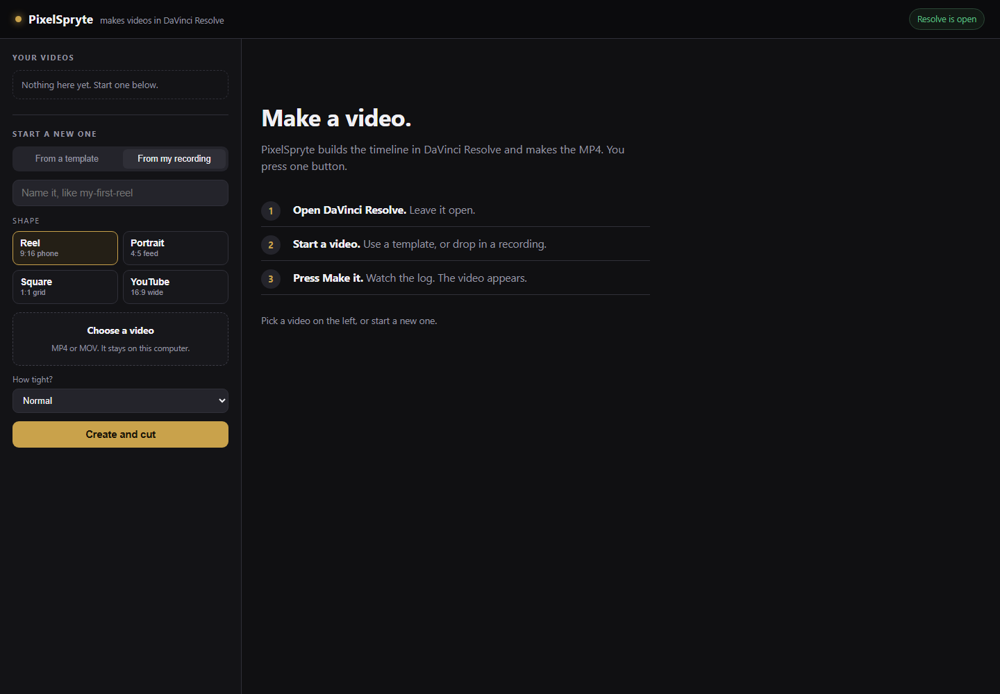

# PixelSpryte

**One JSON brief in. A verified vertical MP4, an editable Resolve timeline and a
review page out.**



<sub>Two ways in: start from a template, or drop in a recording and let it cut the dead air.</sub>

PixelSpryte is a local short-form video builder for DaVinci Resolve. Describe
the reel in one JSON file — footage, generated shots, captions, cards, audio —
and one command builds the timeline, renders the master, probes the file and
writes the review page. No Adobe, no cloud render, no GUI clicking.

| | |
|---|---|
| **Runs on** | your machine, your Resolve, your footage |
| **Costs** | ~$1–8 of fal.ai generation per reel, $0 per seat |
| **Fails** | loudly: a bad render exits non-zero with the ffprobe problems |
| **Leaves you** | `.otio` + `media/` (fully editable), `manifest.json`, `review.html`, contact sheet |

```
brief.json ──> fal.ai shots + ElevenLabs VO ──┐
           ──> online B-roll (licensed) ──────┤
           ──> overlay / caption cards ───────┼──> OTIO ──> Resolve ──> MP4 ──> ffprobe + review
           ──> narration + ducked music ──────┘
```

## What this is, and what it isn't

It is a **file contract**. `brief.json` in, `out/<slug>/` out, plus a manifest
that either passes or fails. A person or an agent can drive the whole thing
with one shell call and read the result without looking at a screen.

It is **not an MCP server**. There is no protocol, no daemon, no session to
keep alive. The interface is a JSON file and an exit code, which is what makes
it cheap to call inside an agent loop and impossible to “half-succeed”.

It is **not a replacement for Resolve**. It owns the boring, repeatable layer —
timing, captions, cards, audio ducking, track order, framing — and hands you a
timeline you can still open and fix by hand for colour, Fusion or taste.

`SKILL.md` contains the same contract written for an agent (Claude Code, Codex,
or anything that reads a skill file). Copy it next to the repo or point your
agent at it.

## The app

```powershell
py -3.12 app.py
```

Then open <http://127.0.0.1:8765>. Pick a video on the left, pick a shape for a new
one, and press **Make it**. The app runs the build, shows the log, and plays the MP4
when it is done. It also links the review page, so you can see the spend, the licences
and the checks without digging through folders.

Two ways in:

- **From a template** — a new brief with placeholder cards and captions, ready to edit.
- **From my recording** — pick an MP4 or MOV, choose how tight to cut, and the app
  finds the pauses with `ffmpeg silencedetect`, cuts them out, writes the brief and
  builds the timeline. No key, no model download.


- Shapes: Reel 9:16, Portrait 4:5, Square 1:1, YouTube 16:9.
- Resolve must be open. The app says so in the top right corner before you press anything.
- The render is forced to the brief's canvas (`FormatWidth`/`FormatHeight`), because
  Resolve's stock presets have no square or 4:5 option.
- No pip installs. The app is one file of standard library Python.

## The old app

`desktop/` holds the original PixelSpryte Control Panel — a dark, Resolve-inspired
desktop app with profile, style, caption and model selectors that runs the whole edit
as five steps (merge → transcribe → plan → timeline → render). It is the July 2026
build, recovered from the old machine's session history. It is **not yet wired to the
engine in this repo**: Gen 1 edits footage from a YAML profile, Gen 2 builds a reel
from a brief. Read `desktop/README.md` before trusting either.

## Run it

Requirements: Windows, DaVinci Resolve Studio (external scripting is a Studio
feature — open it first), Python 3.12, ffmpeg. `doctor.py` checks all four.

```powershell
git clone https://github.com/avalontrials/pixelspryte
cd pixelspryte
powershell -ExecutionPolicy Bypass -File setup.ps1   # deps + environment report
py -3.12 make_demo_media.py                          # synthetic test footage (once)
py -3.12 build_reel.py reels/demo/brief.json         # spine regression test, free
py -3.12 app.py                                      # then open http://127.0.0.1:8765
```

The demo brief needs no API key and no money. It writes `out/demo/` with the
MP4, the `.otio`, the manifest and `review.html`.

Every build lands in `out/<slug>/`:

| File | What it is |
|---|---|
| `<slug>_v1.mp4` | the review master, at the brief's canvas |
| `review.html` | video, filmstrip, spend, licences, verification |
| `review/contact-sheet.jpg` | eight sampled frames |
| `manifest.json` | output probe, checks, fal jobs, audio loudness, licences |
| `fal_ledger.json` + `COST-REPORT.md` | conservative fal.ai spend |
| `<slug>.otio` + `media/` | editable Resolve timeline and staged media |

`reels/` holds your own projects. The reels from my channel are not in this repo.

Flags: `--no-render`, `--keep-project`, `--preset`, `--fal-dry-run`,
`--generate-only`, `--no-fal`.

- `--fal-dry-run` writes `fal_plan.json` with payloads and an estimate and
  spends nothing.
- `--generate-only` resolves every `generate` entry and stops after
  `assets.json` — useful before timing an edit.
- `generate` entries with `"reuse": true` keep an existing file instead of
  submitting again; reused TTS also reloads its word timings.

## Brief schema

```json
{
  "slug": "my-reel",
  "canvas": { "w": 1080, "h": 1920, "fps": 30 },
  "budget": { "limit_usd": 14.0 },
  "characters": [
    { "id": "alex", "name": "Alex", "description": "…",
      "reference": "assets/characters/alex.jpg" }
  ],
  "generate": [
    { "id": "maya_ref", "model": "fal-ai/flux/dev", "kind": "image",
      "size": { "width": 1080, "height": 1920 }, "prompt": "…" },
    { "id": "vo_hook", "model": "elevenlabs/tts/eleven-v4", "kind": "audio",
      "voice": "Chris", "text": "…", "timestamps": true },
    { "id": "shot_hook", "model": "minimax/h3-max/reference-to-video",
      "kind": "video", "duration": 4.6, "resolution": "768P",
      "source_generated": "alex_street",
      "reference_images": ["alex_street", "assets/characters/alex.jpg"],
      "reference_audio": ["vo_hook"], "prompt": "…" }
  ],
  "broll": [ { "id": "kitchen" } ],
  "footage": [
    { "generated": "shot_twoshot", "in": 0.0, "out": 2.2 },
    { "generated": "shot_hook", "in": 1.85, "out": 4.598 },
    { "broll": "living-room", "in": 1.0, "out": 3.5 }
  ],
  "overlays": [
    { "at": 0.0, "dur": 2.0, "card": { "kicker": "YOUR CITY · 2026",
      "headline": "HOW MUCH IS YOUR MORTGAGE?", "y_frac": 0.55 } },
    { "at": 13.9, "dur": 4.0, "graphic": "equity_split",
      "params": { "left_value": "+$85,000", "right_value": "−$28,500" } }
  ],
  "captions_mode": "burn",
  "captions": [ { "start": 2.05, "end": 4.9, "text": "…" } ],
  "audio": {
    "narration": [ { "generated": "vo_hook", "at": 0.35 } ],
    "music": { "path": "assets/music/mixkit-738.mp3", "gain_db": -26 },
    "lufs": -14
  },
  "render": { "preset": "TikTok - 1080p", "name": "my-reel_v1" }
}
```

- `captions_mode`: `"burn"` (overlay track, works everywhere) or `"subtitle"`
  (native subtitle track — exports as soft subs, not burned into the render).
- `y_frac` is the card's vertical anchor. Cards above 0.55 are raised
  automatically when burned captions would collide.
- Paths are project-relative; absent files are a hard error, not a skip.
- `reuse: true` is the safe way to rebuild from already-paid shots.

## Generated shots (fal.ai)

Any shot the footage cannot supply is declared in the brief and made on fal.ai
before the timeline is built. Generated files land in `out/<slug>/gen/` and
enter the same pipeline as filmed media — same framing, same captions, same
checks.

| Model | Use | Planning rate |
|---|---|---|
| `fal-ai/flux/dev` | character / location stills | $0.025 / MP |
| `fal-ai/flux-pro/kontext` | identity-preserving edit, background replacement | $0.04 / image |
| `elevenlabs/tts/eleven-v4` | Chris + second voice, optional word timestamps | $0.08 / 1k chars |
| `minimax/h3-max/reference-to-video` | lip-synced close-ups from one still + one audio take | $0.05 / s |
| `bytedance/seedance-2.5/text-to-video` | two-character establishing shots | ~$0.47 / s at 720p |
| `bytedance/seedance-2.5/image-to-video` | animate one still | ~$0.47 / s at 720p |
| `bytedance/seedance-2.5/reference-to-video` | multi-reference scene (subject to likeness policy) | ~$0.47 / s at 720p |
| `alibaba/wan-3.0/image-to-video` | cheaper image-to-video alternative | $0.05 / s |
| `fal-ai/kling-video/v1.6/standard/image-to-video` | cheap i2v | $0.056 / s |
| `fal-ai/kling-video/lipsync/audio-to-video` | refine an existing talking take | ~$0.20 / request |
| `veed/lipsync/v2` | precise mouth re-sync on an existing take | ~$0.60 / request |

- `source` / `source_generated` chain a job onto a still. `reference_images`
  and `reference_audio` accept local paths or generated ids.
- Seedance and Kling need HTTPS media URLs; those inputs are uploaded to fal's
  CDN and cached in `.fal_uploads.json`. Kontext, H3-Max and Wan accept data
  URIs and avoid the upload.
- `--fal-dry-run` never needs the media to exist; it writes a redacted plan.
- A `budget.limit_usd` is enforced **before every POST**. The manifest and
  `fal_ledger.json` record what was estimated. The fal billing-events endpoint
  may return 403 for a given key; when it does, the report says so rather than
  pretending the estimate is an invoice.

Set the key once, never in chat — create `PixelSpryte/.env` with one line:

```
FAL_KEY=<your key>
```

### The Seedance 2.5 likeness lesson

Seedance 2.5 **reference-to-video** rejects photoreal character references with
`content_policy_violation` (“may contain likenesses of real people”). Its
**text-to-video** endpoint does not take those references and will generate a
scene from the written anchors. In one build the Seedance 720p two-shot is retained as an **alternate only**: its profile did not match
the canonical hero, so the current cut uses H3-Max close-ups plus a VEED v2
lip-sync pass on the exact ElevenLabs takes. Do not promise a client that
Seedance will hold a supplied face; test the exact reference first.

## Online B-roll

The middle of a reel does not need paid generation. `ps/broll.py` carries a
small licensed catalog (`assets/broll/catalog.json`) with source page, licence,
measured duration and dimensions. A brief entry `{ "broll": "kitchen" }` resolves
to a cache-first download under `assets/broll/`, then to a normal `footage` clip.

Current catalog: Mixkit Stock Video Free License items for a city skyline,
modern kitchen, staged living room, calculator/paperwork, laptop research, and
neighbourhood houses. The manifest records every clip's source page and licence;
`review.html` lists them. Arial 16:9 B-roll is cropped to 9:16 by Resolve's
`frame_fill`, so prefer the 1080p download where Mixkit offers it.

## Audio

`ps/audio.py` places the narration takes at their timeline offsets, loops and
ducks a music bed, and writes one 48 kHz stereo WAV:

```
narration takes + `at` offsets
        │
        ├─ asplit ──> audible narration
        │       └───> sidechain key for the music
        └─ music loop ──> ducked bed
                              └──> amix ──> loudnorm ──> A1-mix.wav
```

The mix is measured with `ebur128`; the result is written into `manifest.json`
and shown in the review page. A single A1-mix track is deliberate: it gives a
predictable master while the original takes remain in `gen/` for a re-edit.
Source audio from B-roll or generated video is muted so it cannot leak under the
VO.

## Layout as built

| Track | Contents |
|---|---|
| V1 | footage and B-roll, one clip per cut, exact source in/out |
| V2… | optional extra picture layers, in the order declared |
| V-captions | burned caption cards (one per cue) |
| V-graphics | headline / lower-third / data cards (top) |
| A1-mix | narration + ducked music, loudness-normalised |

Track order in the OTIO stack maps 1:1 to Resolve track numbers. The builder
owns the order — captions above picture, graphics above captions — so a brief
cannot accidentally hide text under B-roll.

## What is verified, not assumed

Every build ends with `ffprobe`: dimensions, fps, frame count, duration, codecs,
audio presence, file size. A run that renders a one-frame file fails loudly.
The first build's manifest also records:

- the Resolve timeline span (880 frames) and track counts;
- the audio integrated loudness and true peak;
- every fal job, model, request id and estimate;
- every B-roll source page and licence;
- the character descriptions and references used.

`review/filmstrip` and `review.html` are written only after the probe passes.

## Cost, measured on four real reels

The point of a reusable library is that the second reel is cheaper than the
first. These are the planning estimates recorded in each build's
`COST-REPORT.md` — conservative, not invoices (fal's billing endpoint returned
403 for this key, and each report says so).

| Reel | Length | New fal spend | What was new |
|---|---|---:|---|
| R01 | 29.33 s | **$7.82** | cast, hooks, lip-sync passes, three side-view stills |
| R02 | 30.31 s | **$3.11** | four loft stills, new VO, three talking bases |
| R11 | 29.91 s | **$2.02** | one penthouse pan, one offer still, two talking shots |
| R12 | 30.40 s | **$1.00** | one fireplace still; CTA shot and audio reused |

The curve flattens because the cast, the b-roll catalogue, the caption and card
templates and the Resolve structure are reused. It never reaches zero: every
new talking shot still pays for motion and lip sync.

## Status

Built for my own channel, used to produce four real reels. Single-operator,
Windows-first, no hosted version, no multi-user anything. It is a tool, not a
product — treat the schemas as stable-ish and the "Not built yet" list as real.

## Resolve facts this code depends on

1. **Media must live under the `.otio`'s directory tree.** A timeline referencing
   files elsewhere on disk silently returns `None` from `ImportTimelineFromFile`.
   `build_reel.py` stages every asset into `out/<slug>/media/` (hardlink, else copy).
2. **Duplicate timeline names fail the import.** The old timeline is deleted first.
3. **Never pass `recordFrame: 0`** — a Resolve timeline starts at 01:00:00:00, the
   clip lands outside it, and the render silently becomes one frame.
4. **`TimelineItem` has no `GetClipProperty`.** Go through `GetMediaPoolItem()`.
5. **OTIO stack order == Resolve track order** (first track → V1, bottom).
6. **Subtitle tracks do not burn into the render** by default, so reels use
   overlay caption cards for burned captions.
7. **Python 3.12 only.** 3.11 segfaults importing `fusionscript.dll`.
8. **Numbered still names can break the OTIO importer.** Caption cards and overlay
   cards use letter suffixes (`cap_a_…`, `card_a_…`), never `00_x.png`.
9. **A full-frame PNG overlay imports correctly only when its track is above the
   picture.** The builder puts captions and graphics on their own top tracks.
10. **A project can be behind a modal dialog.** `CreateProject`/`LoadProject`
    returning `None` usually means a Resolve dialog (software update, missing
    media) is open, not that the API is broken.

## Not built yet

- word-level karaoke captions (per-word highlight)
- a reference-locked two-character shot (Seedance reference-to-video is blocked
  by its likeness policy; the approved three-quarter still is used as an
  over-the-shoulder H3-Max shot instead)
- a multi-reel batch runner
- native editable Resolve text titles (cards are PNG overlays by design)
- a proper music library beyond one Mixkit bed
- frame-accurate review annotations in the HTML page

## Moving to another machine

The code carries no machine-specific paths. `ps/paths.py` discovers the Resolve
install (env overrides win: `RESOLVE_SCRIPT_API`, `RESOLVE_SCRIPT_LIB`,
`RESOLVE_EXE`), and `doctor.py` reports what the new box is missing.

```powershell
py -3.12 package.py                        # writes dist/PixelSpryte-portable.zip + .bundle
# on the new machine:
winget install Python.Python.3.12
winget install Gyan.FFmpeg
powershell -ExecutionPolicy Bypass -File setup.ps1
py -3.12 doctor.py
```

**What travels and what doesn't:**

| Moves | Does not move |
|---|---|
| briefs, `ps/`, fonts, B-roll/music catalogs, requirements | Resolve's project database (per machine) |
| `out/<slug>/` — self-contained reel folder | `.env` (secrets stay off disk images) |
| the `.otio` + `media/` next to it | `assets/broll/*.mp4`, `assets/music/*.mp3` (re-downloadable) |

A Resolve project is **not** the deliverable — the brief is. Rebuilding a reel
from its brief takes seconds when the generated media is reused, so
cross-machine work means copying the brief, the generated shots and the source
media, then re-running `build_reel.py`. The `out/<slug>` folder stays valid
because the `.otio` references `media/` beside it.

**Hardware note:** this machine (RTX 3080 Laptop, 32 GB) renders 1080×1920 in
~4 s. The bottleneck is generation, not the edit: Seedance 2.5 720p takes
minutes, while the Resolve timeline and review artifacts are effectively
instant.
